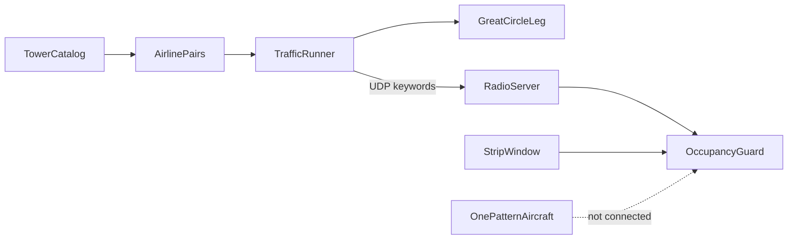
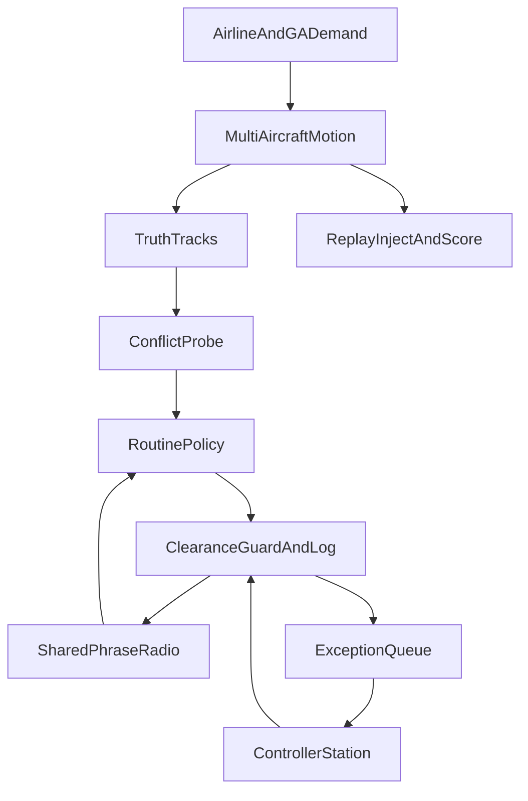

# National tower training simulation

## Contract for the year

This stays simulation software. No live facility, no radio hardware, and no certification claim. The version already in the tree is the base: public tower catalogs, UDP radio, great-circle cruise, and Docker. [plans/version-2-national-radio-simulation.md](plans/version-2-national-radio-simulation.md) still says the runway rules stay unchanged. This plan reverses that one decision. The transport, the pins, and the refusal to paste phraseology tables stay.

Month 12 means every US tower airport can run the same training software. A human plays the controller only for exceptions, weather judgment, and emergencies. The software issues routine taxi, sequence, landing, takeoff, and handoff clearances, and it holds the picture so the human is not the memory. Shadow means replay and scoring inside the sim, not a feed from a live cab.

If the year gets tight, cut in this order and no earlier: collision probe and unsafe-clearance refusal, then those five routine clearances on the common case, then the exception package, then one Class D pattern and one multi-runway airline field, then sharded national runs. Helicopters, rich taxi graphs, and historical-track replay come after that.

## What is actually built

Five programs, plus data and proof, and they do not yet form one cab.

- [apps/atc_tower](apps/atc_tower) is an Erlang/Ra clearance log. [apps/atc_tower/src/atc_separation.erl](apps/atc_tower/src/atc_separation.erl) is a phase machine: `queued`, `hold`, `occupying`, `air`, `gone`. The safety property is one occupier per runway, queue head only, and no use of a closed or wrong-designation runway. Intersecting or dependent runways share that exclusion. Commands are assign, hold short, line up, takeoff, land, go around, vacate, handoff, and link.
- [apps/atc_tower/src/atc_bounds.erl](apps/atc_tower/src/atc_bounds.erl) refuses an airport outside 4 runways, 8 aircraft, and 2 neighbors. Atlanta, Denver, and O'Hare cannot load. Eight aircraft is below a busy training pattern.
- [apps/atc_radio](apps/atc_radio) speaks keyword English on one UDP port per frequency and appends a JSONL log per flight. Tower mode submits a command only when a keyword hits. Everything else gets a scripted reply that is not a separation decision. Enroute mode never opens the tower.
- [apps/atc_frontend](apps/atc_frontend) is an egui strip window on `127.0.0.1`. It shows queues and submits the same commands. Its own banner says it is not a live facility. There is no surface map.
- [apps/aircraft](apps/aircraft) is one civil aircraft, one runway, one pattern, in-memory link. Tests answer it with [apps/aircraft/tests/scripted_tower.py](apps/aircraft/tests/scripted_tower.py), not with the Erlang tower. [apps/physics/physics.c](apps/physics/physics.c) flies a separate great-circle climb, cruise, and descent. Nothing joins that state to the pattern.
- [tools/navdata](tools/navdata) and [tools/traffic](tools/traffic) import OurAirports, one NASR cycle, and one T-100 month, then fly a handful of airline pairs one after another. Wind in the generated airport file is the fixed string `270 at 10`. General aviation is omitted on purpose. Taxi is a straight line to a hold-short point.
- [specs/tla/AtcTower.tla](specs/tla/AtcTower.tla) and the StrictDoc trees under [reqs](reqs) and [reqs/aircraft](reqs/aircraft) match this envelope. They are evidence for the occupancy guard, not for a national cab.

## Coverage against the cab

A tower controller's work is scan, remember, predict, decide, speak, and catch the case that is no longer routine. Mapped to today:

- **Runway exclusion.** Covered for a marked occupier, including a configured intersection. Not covered in time or distance. Two aircraft can be "safe" in the model and still occupy the pavement together, because the model has no positions.
- **Sequence.** A FIFO index and the phrase "number N". No interval, no gap, no speed, no "traffic to follow".
- **Taxi, landing, takeoff, handoff.** The commands exist and can be refused. Nothing decides them. The radio does not fly the aircraft. Handoff with `accept=false` is a successful no-op. There is no release from approach and no transfer of identity.
- **Collision prediction.** Absent in the air, in the pattern, and on the taxiway. No wake, no runway-incursion geometry, no occupancy timer, no go-around versus departure.
- **Scan and strips.** The window redraws the queue. There is no flight plan, altitude, route, beacon, ATIS letter, readback flag, or amendment.
- **Readback.** The pilot model can speak one. Nobody compares it to the clearance.
- **Weather.** A wind string copied into the takeoff paraphrase. No ceiling, visibility, altimeter, wind shear, braking action, or runway change. Designation changes only by editing TOML and restarting.
- **The rest of the cab.** No clearance delivery, no ground-versus-local split, no vehicles, no NORDO, no emergency response. Mayday and Pan-Pan are spoken by the aircraft and do not change the maneuver. The tower does not answer them.
- **National operations.** The catalog can list towered fields. A run does not exercise them. Demand is airline city pairs only, so a Class D training airport, which is where most tower memory is spent, stays empty.
- **Proof.** TLC and PropEr cover the occupancy invariant inside 4, 8, and 2. [specs/refinement/Mapping.md](specs/refinement/Mapping.md) still has open refinement obligations. Raft is assumed, not proved.

Routine work the software should take: who is where, who is next, which taxi keeps them clear, whether the runway will be empty, the phrase, the readback check, and the handoff or release. Judgment that stays human: weather and runway configuration, emergencies, and any case the probe cannot show is safe. The software still holds that case in front of the controller. It does not hand back a blank strip.

## Edge cases this plan closes

- General aviation and closed traffic are in. Without them, most towers have nothing to control.
- Vehicles and runway inspections are in. They are a large share of incursions.
- Helicopters are a simplified second-half model, after the fixed-wing pattern works.
- Approach and center are a neighbor that can accept a handoff and issue a release. Full vectoring and enroute separation are out of this year.
- Phraseology stays a project-owned grammar with the information order from the FAA orders. The orders are not pasted in as tables.
- Every tower gets a synthetic taxi graph: runway, a parallel, and connectors. A published airport-surface layout is used only where a public source already exists.
- Wake is classic heavy, B757, large, and small. RECAT waits.
- The formal envelope stays 4, 8, and 2 for TLA+ and the checked profile. The training profile has its own limits so the proof is not thrown away to load Denver.
- Weather state gates routine clearances. The controller chooses the configuration. The software does not pick a runway in weather.
- An emergency or a non-routine aircraft freezes routine clearances that would conflict, and the controller gets one package: state, conflict, last clearance, who else is affected.
- LAHSO, visual separation, opposite direction, and intersection departures are detected and deferred. They are not auto-issued.
- The egui window becomes the exception station. No second client.
- Every tower is in the catalog and runs the same code. A scenario is a shard: one airport, a region, or a national run. One machine is not required to fly every busy tower in realtime.
- Shadow replay of public historical tracks is a later mode, and only after the license is checked. Bulk tracks stay out of git, same as the navdata downloads.
- Still no certification claim and no live control.

## Target shape

The clearance guard remains the only writer of an issued clearance. The probe and the routine policy may only propose a command the guard can accept. If they cannot show the case is routine and safe, the command goes to the exception queue. Scripted radio replies stop being a second, silent authority.

New predictive state sits beside the phase machine, not inside the TLA model: position, velocity, altitude, wake class, and a time window for runway use. The discrete model keeps exclusive occupancy, head-of-queue, designation, and closed runways. A training scenario that needs more aircraft uses the training profile. `make tla-check` keeps the small one.

## Twelve months

**Months 1–2. One traffic picture.** Connect the aircraft phrasebook, the radio, and `atc_service:submit`. Run more than one aircraft. Split the checked envelope from the training profile. Hand the pattern state to `phys_step` without a position jump. Publish a truth track each step. Add StrictDoc requirements for tracks, the probe, the routine policy, and the exception queue before the new behavior lands.

**Months 3–4. Collisions the occupancy flag cannot see.** Synthetic taxi graph, runway-incursion check, classic wake, and same-runway time separation. Predict whether the runway is clear when the arrival or the departure gets there. Auto-issue taxi, hold short, line up, takeoff, land, and vacate only when that prediction and the guard agree.

**Months 5–6. The pattern, where the memory load is.** GA and flight-school demand. Several aircraft in the pattern. Sequence as an interval. Traffic calls. Readback check. Go-around put back into the sequence. VFR closed traffic and IFR straight-in are the two routine local patterns.

**Months 7–8. The rest of the cab's memory.** Clearance delivery, ground, local, and flight data as frequencies. A routine IFR clearance when the route is in the nav data. Handoff and release with the approach neighbor. Strips that remember the plan, the ATIS letter, and the readback. Weather state that stops routine issuance. Vehicles. The exception station on the current window.

**Months 9–10. The national training machine.** Demand for every towered airport: T-100 plus GA scaled from public operation counts. Sharded runs. Record, replay, and instructor injects for emergency, NORDO, vehicle, deviation, and weather. Score losses of separation, incursions, deferred clearances, and radio time. Prove it on one busy airline field and one Class D, not only the scripted city pair.

**Months 11–12. Exceptions stay safe at peak.** Emergency and weather paths keep separation for everyone else. Phrase audit for the routine set. A peak-day run whose aircraft count is past today's cap of 8. A written list of what is still out: full approach control, enroute separation, LAHSO, PRM, visual-separation judgment, live NAS connection, and certification.

## What month 12 will not be

It will not be a certified replacement for a tower, STARS, ERAM, or ASDE-X. It will not vector a TRACON or separate an enroute sector. Airports without a published surface layout will train on the synthetic graph. The formal proof will still be the small discrete model, with scenario tests covering the continuous probe.

## Work items

1. Save this plan as `plans/national-tower-training-simulation.md` and commit it before other work.
2. Add StrictDoc requirements for truth tracks, the conflict probe, the routine clearance policy, and the exception queue, and keep the 4/8/2 model as the checked profile.
3. Connect aircraft, radio, and tower; run multiple aircraft; split the training profile from the formal envelope; make pattern and enroute motion one continuous track.
4. Add a synthetic taxi graph, runway-incursion checks, classic wake, and time-based runway separation, and auto-issue routine surface and runway clearances only when the probe and the guard agree.
5. Add GA and closed-traffic demand, interval sequencing, traffic calls, readback checks, and go-around reinsertion.
6. Split clearance delivery, ground, local, and flight data; add routine IFR clearances, handoff and release, weather gating, vehicles, and the exception station on the egui window.
7. Drive every towered airport with airline plus GA demand, shard the runs, and add record, replay, instructor injects, and debrief scores.
8. Harden emergency and weather paths, audit routine phraseology, run a peak day past the old 8-aircraft cap, and write the residual gap list.
