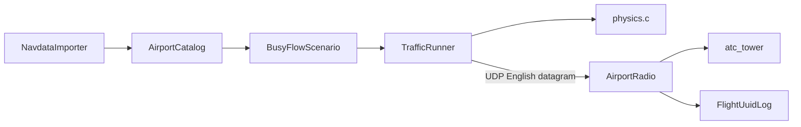

# Version 2 national radio simulation

## Decisions

The ten scope choices are closed as follows.

- National skeleton. Import every public US tower airport. Start containers only for airports that appear in the scenario. The scenario is the busiest domestic city pairs in one pinned BTS T-100 month, and it always includes San Francisco (SFO/KSFO) to Chicago O'Hare (ORD/KORD).
- New radio and log servers are the stress target. [apps/atc_tower/src/atc_separation.erl](apps/atc_tower/src/atc_separation.erl) and the existing command tuples stay the runway clearance brain. The radio server translates only the English that already maps onto those tuples. It does not grow enroute separation rules.
- [physics.c](apps/physics/physics.c) integrates climb, cruise, descent, and the great-circle path. [apps/aircraft/src/aircraft/dynamics.py](apps/aircraft/src/aircraft/dynamics.py) still owns taxi and the local pattern.
- One UDP datagram is one transmission. Inside an airport container, the port is `20000 + round((mhz - 118.0) / 0.025)`. The same frequency may be reused at another airport because each airport has its own container address. The spoken facility name separates two services at one airport that share a frequency.
- The radio is software only. A caller tunes by addressing that airport and port. There is no SDR hardware path.
- Time scale is `1`, `10`, `100`, or `max`. Finite scales sleep `sim_step / scale`. `max` does not sleep. Every log line carries the simulated clock.
- Data sources are OurAirports, one pinned FAA NASR cycle, and one pinned BTS T-100 month. Bulk files are downloaded into the build, not committed. T-100 is scheduled airline service, so the load and the busy-ness proxy omit general aviation.
- One UUID per flight. The log has `departure`, `enroute`, and `arrival` chapters. SFO departure and ORD arrival are chapters of that same flight.
- Each started airport container is one BEAM node. `+S` comes from coarse buckets of T-100 departures plus arrivals at that airport: under 50 operations uses 1 scheduler, under 300 uses 2, under 1000 uses 4, and the rest use 8.
- Phraseology covers the AIM and JO 7110.65 information needed for clearance delivery, taxi, takeoff, climb, handoff, descent, approach, and landing. Requirements name the information order. The repository does not paste phraseology tables.

This remains simulation software. It does not claim a live facility connection or certification approval. The `v0.0.1` tag stays where it is.

## Shape

- `tools/navdata/` downloads the pinned sources and writes a catalog of tower airports, runways, and frequencies, plus city-pair counts.
- `apps/atc_radio/` is the new Erlang application. It binds one UDP socket per frequency, appends the flight log, and submits a mapped command with `atc_service:submit/3` only when the English is one of today's commands: assign, hold short, line up, takeoff, land, go around, vacate, handoff, or link.
- English the current brain does not decide, including IFR route clearance, climb, center handoff, descent, and approach, is still transmitted and logged. A small scripted facility answer in the radio app supplies the reply so the log is a complete exchange. That answer is not a new separation authority.
- One enroute radio container owns the center frequencies named by the scenario. It does not start one container per ARTCC sector.
- `apps/physics/physics.c` exposes `phys_step`. The Python aircraft calls it after the departure pattern and stops calling it at arrival pattern entry. Cruise altitude, climb rate, descent rate, and true airspeed come from a small performance table keyed by aircraft category, not from a live fleet feed.
- T-100 has no tail numbers. The runner synthesizes a stable call sign per flight for the run and stores it beside the UUID.
- `docker/` builds the airport image and the traffic image. A generator emits a compose file for the scenario airports, the enroute radio, and the traffic runner. Scheduler count is an environment value on each airport service.

## Protocol and log

A datagram is UTF-8 text:

- line 1: `flight <uuid> <chapter> <callsign>`
- line 2: one plain-English transmission

The radio appends simulated time, airport, frequency, port, direction, and both lines under that UUID. A flight is complete when the departure chapter contains the takeoff exchange and the arrival chapter contains the landing exchange.

## Verification

- Import test: pinned fixtures, not a network call, produce KSFO and KORD with at least one frequency each.
- Radio test: an SFO departure datagram on the tower frequency is logged under the flight UUID and, when it maps to takeoff, reaches the existing tower command path.
- Physics test: an SFO to ORD step sequence reaches the ORD terminal area, and two runs with the same inputs match.
- Compose smoke test: scale `max` for the SFO to ORD flight writes both chapters without a sleep, and the busiest-flow scenario starts one container per used airport with the bucket scheduler count.
